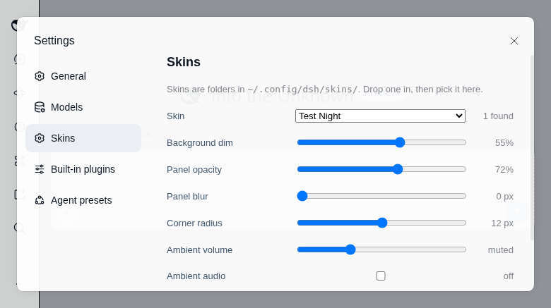

# dsh-skin

Folder-based skins for **DeepSeek Harness Web**: image or video backgrounds, translucency, colour
tokens, custom logo and wordmark, ambient audio.

A skin is a folder. Drop it in, pick it in **Settings → Skins**, done. No build step, no upload
dialog, nothing leaves the machine.



## Requirements

- dsh `0.2.2-rc.x` (the client and settings peers are pinned to that range).
- The **web** profile (`dsh web`). The desktop app uses a different client carrier and is not
  supported yet.

## Install

```bash
# from a local checkout
dsh plugin --profile web add /path/to/dsh-skin

# or straight from the repository
dsh plugin --profile web add github:YOURNAME/dsh-skin
```

Restart `dsh web`. The plugin's host half registers `/dsh-skin` and serves the skins directory.

If your dsh is not `0.2.2-rc.x`, the compatibility gate refuses the plugin; adjust the peer ranges in
`package.json` or install with an exemption.

## Add a skin

```bash
mkdir -p ~/.config/dsh/skins
cp -r my-skin ~/.config/dsh/skins/
```

Then reload the page and choose it under **Settings → Skins**.

```
~/.config/dsh/skins/my-skin/
├── skin.json
├── logo.svg
├── background.jpg     (or .mp4 / .webm)
└── ambient.mp3        (optional)
```

Full format, field by field, with the colour tokens and the drawing rules for the logo:
**[SKIN-FORMAT.md](SKIN-FORMAT.md)** — written to be handed to a designer.

Minimal working skin:

```json
{
  "name": "Aegean",
  "background": { "file": "background.jpg", "dim": 0.55 },
  "colors": { "dark": { "bg-layer-1": "#0d1a2b", "brand-primary": "#5fc8ff" } }
}
```

## What you can change

- **Background** — image or video, called `cover` / `contain` / `fill` / `repeat`, positioned, dimmed
  and blurred.
- **Surfaces** — panel opacity, backdrop blur, corner radius. Every `--dsw-alias-bg-*`,
  `label-*`, `border-*`, `button-*`, `state-*` token can be overridden per light/dark mode.
- **Logo and wordmark** — replace the mark with your own SVG/PNG/WebP and rename the product.
- **Ambient audio** — a looping file, or the video's own track, muted by default with a volume
  slider.

Five controls stay live in the UI (dim, panel opacity, blur, radius, ambient volume) and override the
skin's own values per browser. Everything else is edited in `skin.json`.

## Safety

A skin is **data plus media**: no CSS, no scripts, no HTML. Unknown fields are ignored rather than
executed. The folder is served by the plugin's own host route behind the same authenticated session
as the GUI, and nothing is uploaded anywhere.

## Known limitations

- Video and audio playback are wired through a `<video>`/`<audio>` element with HTTP range support,
  but were not verified end to end in the development environment (its headless browser has no media
  decoder). Verify on a normal desktop browser.
- Logos and the wordmark are applied to the existing brand seat by hiding the shell's own mark and
  painting the skin's assets in the same box, because the sidebar brand slots do not accept an
  out-of-tree occupant on 0.2.2-rc.1.
- One skin directory is read at a time; switching skins re-reads the manifest but not the media.

## Development

```bash
pnpm install
node scripts/build.mjs        # writes lib/index.js (host) and lib/client.js (browser)
```

`lib/` is committed, so installing elsewhere needs no build.

## Licence

MIT.
