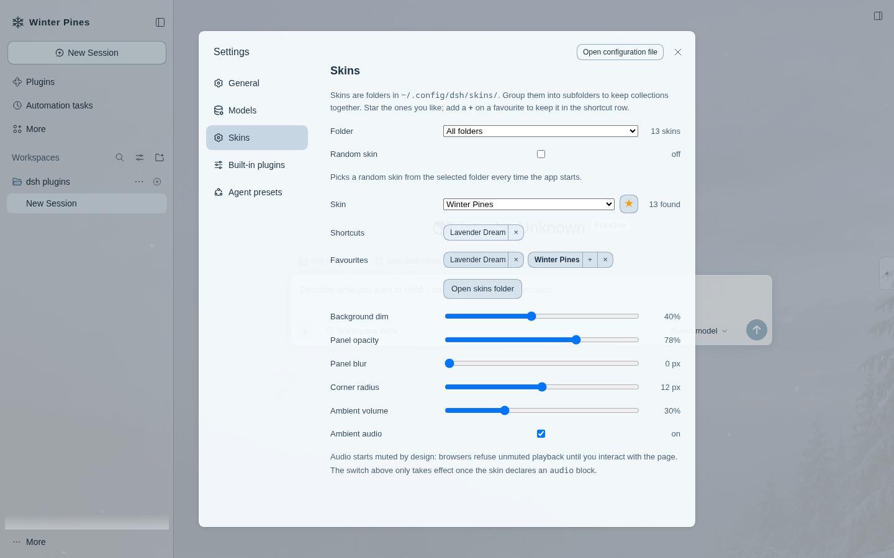
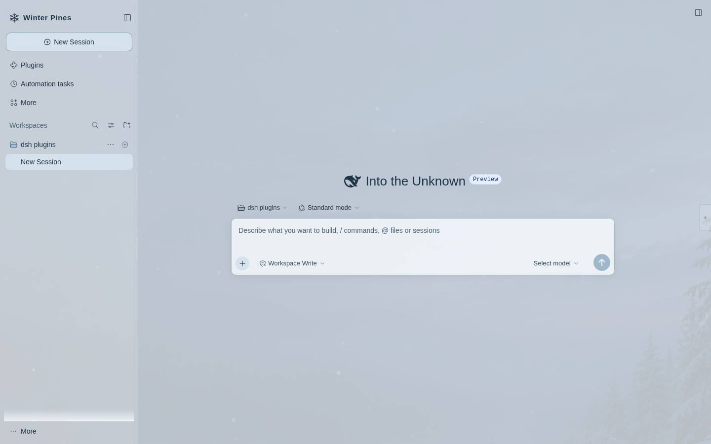

# dsh-skin

[English](README.md) · **简体中文**

给 **DeepSeek Harness Web** 换皮肤：一张壁纸铺在底下，整个界面浮在上面。

皮肤就是一个文件夹。放进 `~/.config/dsh/skins/`，刷新页面，在 **设置 → 皮肤** 里选一下就行。
支持图片或视频背景、半透明面板、自定义配色、自定义 logo 和文字标识，以及可选的背景音乐。
不需要构建，没有导入对话框，什么都不会上传。



## 环境要求

- dsh **0.2.2-rc.x**。客户端依赖锁在这个范围内，版本不匹配时插件管理器会直接拒绝，而不是装一半。
- **web** 配置档（`dsh web`）。桌面版加载客户端的方式不同，暂不支持。

## 安装

```bash
# 从本地目录
dsh plugin --profile web add /path/to/dsh-skin

# 或者直接从 GitHub
dsh plugin --profile web add github:bigm4ngo/dsh-skin
```

重启 `dsh web`，然后打开 **设置 → 皮肤**。

不会往系统里装任何东西：`dsh plugin` 只把包装进这个配置档自己的 `node_modules`，而 `lib/` 里是
预编译好的产物，所以你那台机器不需要编译器，也不需要跑构建。

## 做一个皮肤

完整格式——每个字段、能改的颜色变量、logo 的画法——都在 **[SKIN-FORMAT.md](SKIN-FORMAT.md)** 里。
那份文档是写给设计师看的，不只是写给程序员的。

简版：

```
~/.config/dsh/skins/harbour/
├── skin.json
├── background.jpg      （或 .mp4 / .webm）
├── logo.svg            （可选）
└── ambient.mp3         （可选）
```

```json
{
  "name": "Harbour",
  "background": { "file": "background.jpg", "dim": 0.5 },
  "colors": {
    "dark":  { "bg-layer-1": "#0b1524", "brand-primary": "#7ad1ff" },
    "light": { "bg-layer-1": "#ffffff", "brand-primary": "#1b6f9e" }
  }
}
```

刷新页面，它就会出现在列表里。如果有问题——文件不存在、颜色值写错、视频 300 MB——皮肤会被拒绝，
原因会显示在下拉框下面，而不是悄悄套用上去。



## 可以改什么

- **背景**：图片或视频；`cover` / `contain` / `fill` / `repeat`；位置；压暗程度；模糊。
- **面板**：不透明度、背景模糊、圆角，以及任意 `--dsw-alias-*` 颜色变量，明暗两套模式分别设置。
- **Logo 与文字标识**：用自己的 SVG/PNG/WebP 替换产品图标，用一段文字替换产品名称。
- **环境音**：一个循环播放的音频文件，或者直接用视频自带的音轨；默认静音，带音量滑块。
- **收藏**：给常看的皮肤点星标；收藏的皮肤会排在选择列表最前面，并保留在快捷选择栏里，和其他
  偏好一样按浏览器记住。

其中五项可以在界面里实时调整（压暗、面板不透明度、模糊、圆角、音量），按浏览器分别记住。其余
全部写在 `skin.json` 里，所以设计师可以把效果定好，用户不用自己调。

## 注意事项

- **视频和音频的播放链路已经接好，但没有在本机验证过。** 开发机的无头浏览器没有媒体解码器，测试时
  画面永远出不来。元素、按字节范围的分段传输、静音与音量逻辑都在，但请先在正常的桌面浏览器里确认
  一次再当真。
- **品牌替换是作用在原有位置上**，不是走侧边栏的品牌插槽：0.2.2-rc.1 上这些插槽不接受外部插件占用。
  实现方式是隐藏自带的图标，把皮肤的 logo 画进同一个盒子里，布局不变。
- 界面里的类名在构建时会被哈希，所以插件靠几何尺寸和稳定的类名后缀来找外层容器，而不是写死的选择器。
  以后 dsh 改版可能会移动它们；如果哪天壁纸不透出来了，先查这里。
- 同一时间只启用一个皮肤。切换皮肤会重新读清单，但不会重新加载媒体文件。

## 实现结构

两半，都很小：

- **宿主端**（`src/index.ts`）在 web 服务器上注册 `/dsh-skin`，把皮肤目录提供出去：列表在
  `/dsh-skin/index.json`，媒体在 `/dsh-skin/<皮肤>/<文件>`，带 HTTP Range 支持，视频才能边下边播。
  读取时会校验每个清单。
- **浏览器端**（`src/client/`）拉取列表、铺背景层、在真正声明设计变量的那个元素上覆盖变量，并注册
  设置页里的皮肤分区。

皮肤只是数据和媒体：没有 CSS、没有脚本、没有 HTML。不认识的字段会被忽略，不会被执行。

## 开发

```bash
pnpm install
node scripts/build.mjs     # 产出 lib/index.js（宿主）和 lib/client.js（浏览器）
```

`lib/` 是提交进仓库的，所以从新克隆的仓库安装时不需要再构建。

## 许可证

MIT。
